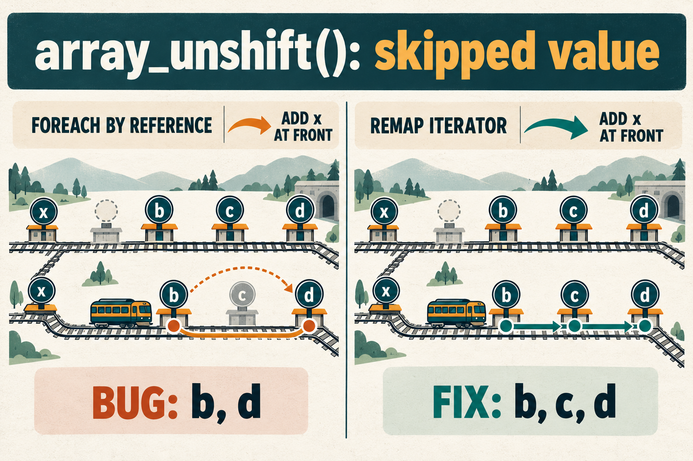

# array_unshift can skip a value during foreach

Issue: [php/php-src#25107](https://github.com/php/php-src/issues/25107).

This AI-generated illustration uses a railway theme. The routes and labels were visually checked against the executed reproduction. The exact native image-generation prompt is in [prompt-used.txt](prompt-used.txt).

In a `foreach` by reference, PHP keeps an iterator position as the array changes. Deleting an entry leaves an empty slot in the array's internal table.

When `array_unshift()` adds a value at the front, it rebuilds the table without those empty slots. The iterator can still be adjusted using its old position, causing it to skip an unvisited value. In the reproduction, the loop sees `b, d` instead of `b, c, d`.

The proposed fix maps each old iterator position to its position among the remaining live slots, then applies the offset for the values added at the front. This preserves the next value to visit.

The initial regression failed before the fix and passed afterward on PHP 8.7.0-dev. Publication was then validated on PHP-8.4 commit `dfcc0433fcda7fb732cba8d7ee8c857d23f9a9e7` with debug and ZTS enabled. The new PHPT failed before its fix and passed afterward. The selected suite reported 876 passed and 13 skipped, with zero unexpected failures or warnings. The build and validator exited 0. The complete PHP suite and Windows builds were not run.

See the [public bug report](https://github.com/php/php-src/issues/25107) for the reproduction and related pull request.

Pull request: https://github.com/php/php-src/pull/25111.
