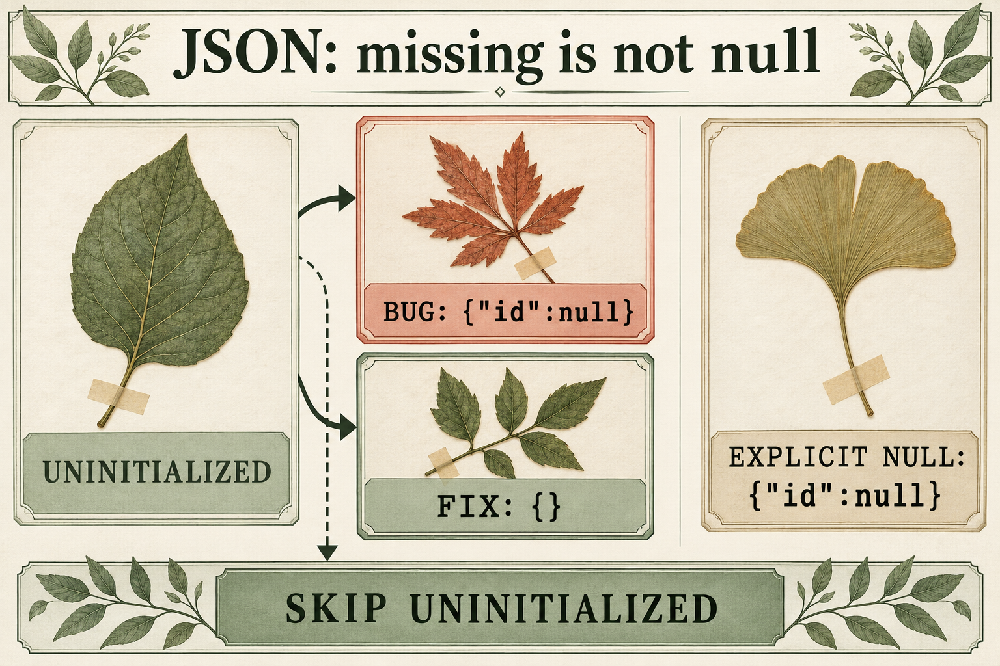

# JSON distinguishes a missing property from null

Issue: [php/php-src#25108](https://github.com/php/php-src/issues/25108).

This AI-generated illustration uses a botanical catalog theme. The JSON labels were visually checked against the executed reproduction. The exact native image-generation prompt is in [prompt-used.txt](prompt-used.txt).

`json_encode()` converts public object properties into JSON fields. A typed property that has not been initialized should be omitted from the output.

If that backed property has a setter hook, the encoder can include it as `{"id":null}` even though it has no value. For the uninitialized property in this example, the expected JSON is `{}`.

The proposed fix skips the internal uninitialized marker before writing the property name. A separate nullable property explicitly initialized to `null` still appears in JSON, as does a getter that returns `null`.

The initial regression failed before the fix and passed afterward on PHP 8.7.0-dev. Publication was then validated on PHP-8.4 commit `dfcc0433fcda7fb732cba8d7ee8c857d23f9a9e7` with debug and ZTS enabled. The new PHPT failed before its fix and passed afterward. The selected suite reported 291 passed and 5 skipped, with zero unexpected failures or warnings. The build and validator exited 0. The complete PHP suite and Windows builds were not run.

See the [public bug report](https://github.com/php/php-src/issues/25108) for the reproduction and related pull request.

Pull request: https://github.com/php/php-src/pull/25110.
