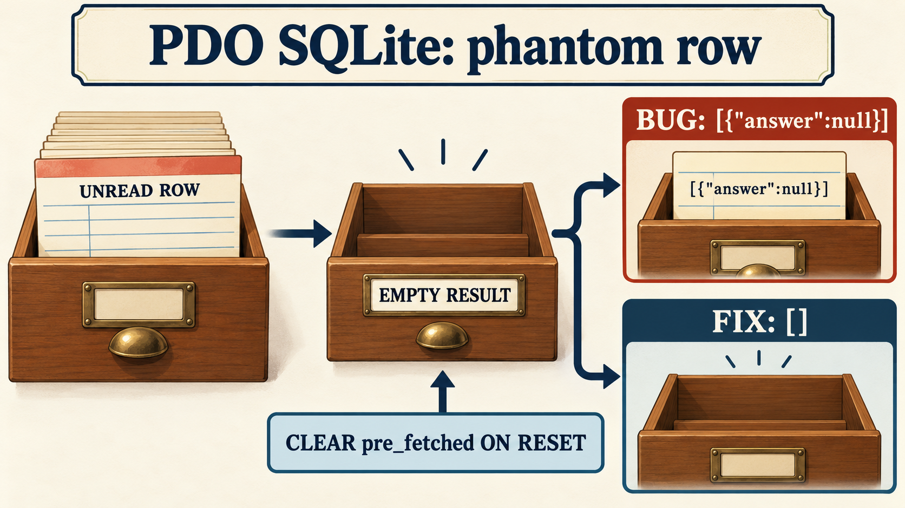

# PDO SQLite can return a phantom row

Issue: [php/php-src#25106](https://github.com/php/php-src/issues/25106).

This AI-generated illustration uses a library-card theme. The displayed JSON and labels were visually checked against the executed reproduction. The exact native image-generation prompt is in [prompt-used.txt](prompt-used.txt).

PDO lets an application prepare a SQLite query once and execute it with different parameters. The SQLite driver keeps track of a prefetched row until the application reads it or the cursor resets.

If the application executes a statement again while a previous row is unread, and the new execution has no rows, `fetchAll(PDO::FETCH_ASSOC)` can return `[{"answer":null}]` instead of `[]`. An explicit `closeCursor()` before the second execution also reproduces the problem.

The cursor resets the SQLite statement but leaves the `pre_fetched` flag set. The proposed fix clears that flag during the reset, so a later empty result stays empty.

The initial regression failed before the fix and passed afterward on PHP 8.7.0-dev. Publication was then validated on PHP-8.4 commit `dfcc0433fcda7fb732cba8d7ee8c857d23f9a9e7` with debug and ZTS enabled. The new PHPT failed before its fix and passed afterward. The selected suite reported 171 passed, 9 skipped, and one existing expected failure, with zero unexpected failures or warnings. The build and validator exited 0. The complete PHP suite and Windows builds were not run.

See the [public bug report](https://github.com/php/php-src/issues/25106) for the reproduction and related pull request.

Pull request: https://github.com/php/php-src/pull/25109.
