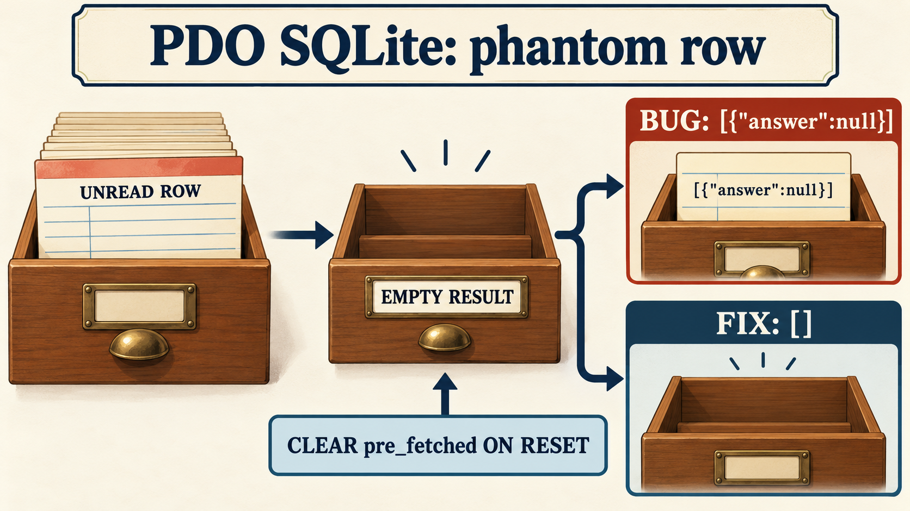
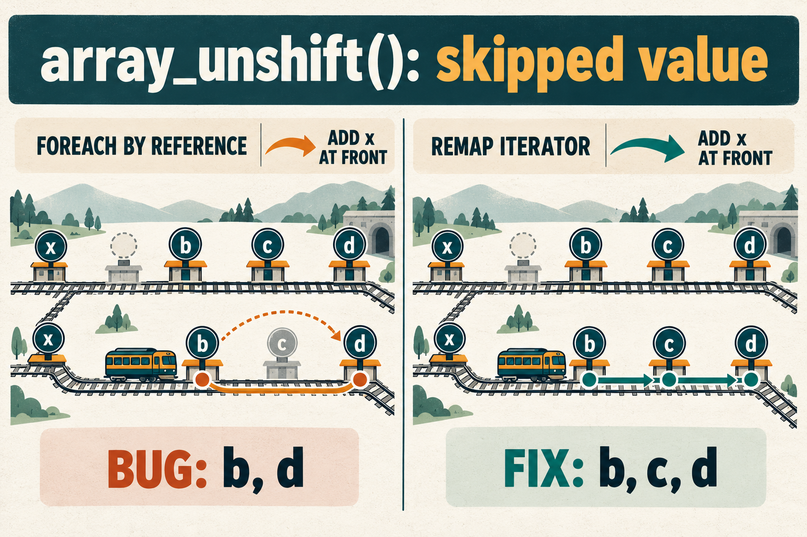

# Illustrations for three PHP functional bug reports

The illustrations explain the symptoms and proposed corrections. The issue reports contain executable reproductions and expected outputs. The images are conceptual explanations, not screenshots of test results.

## PDO SQLite, library checkout cards

A stale marker can retain an unread row after resetting a query. Clearing the marker makes an empty result stay empty.

[Issue #25106](https://github.com/php/php-src/issues/25106) · [Explanation and prompt](assets/pdo/infographic_report.md).

## array_unshift, railway routes

Removing empty slots changes positions inside the array. Remapping the iterator preserves every unvisited value on the route.

[Issue #25107](https://github.com/php/php-src/issues/25107) · [Explanation and prompt](assets/array/infographic_report.md).

## JSON, botanical catalog

An uninitialized field has no value and is omitted. An explicitly initialized null remains present in the serialized object.

[Issue #25108](https://github.com/php/php-src/issues/25108) · [Explanation and prompt](assets/json/infographic_report.md).

All three images were generated with the native imagegen tool. Each artifact is saved as `infographic.png` in its own directory. The base prompt generator was run directly with Python; its structured outputs and the exact final generation prompts are stored beside the images.
